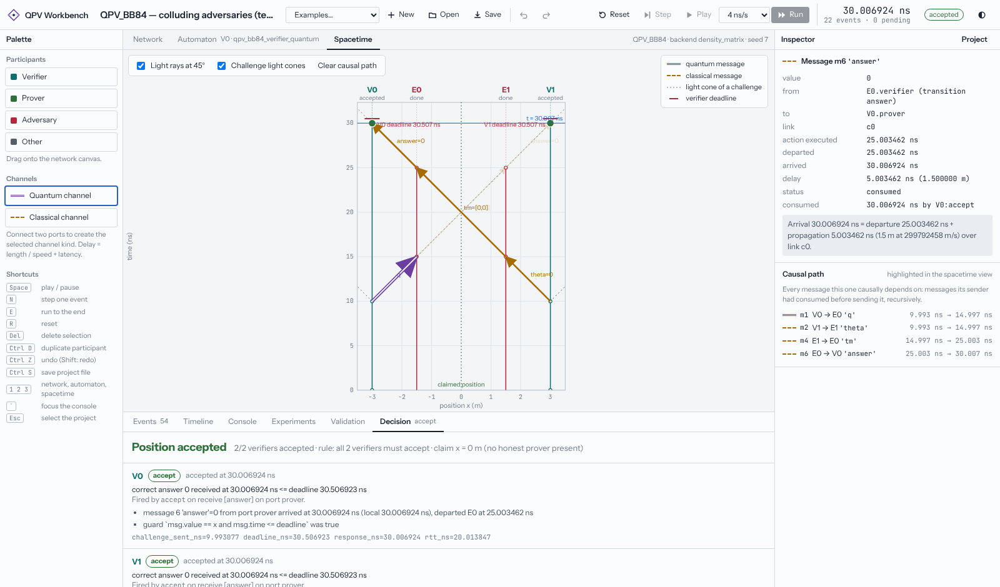

# QPV Workbench

An event-driven, quantum-capable, adversary-aware simulation workbench for
**Quantum Position Verification (QPV)**.

Researchers can:
- design protocols visually as participant state machines;
- execute them in a deterministic discrete-event engine with exact femtosecond timing and pluggable quantum backends;
- inspect every state transition, message and timestamp;
- attack protocols with capability-limited, colluding adversaries;
- run reproducible statistical experiments.

> **What this is, and is not.** The workbench reports what a *modelled* protocol does under *modelled* physics and adversaries.
> - A simulated acceptance rate is evidence about that model. It is not a security proof.
> - The adversary strategies shipped here are specific automata, so their success rates are lower bounds on what attackers can achieve.
>
> See [LIMITATIONS_AND_ROADMAP.md](LIMITATIONS_AND_ROADMAP.md).



## Quick start

**In the browser:** open <https://qubitman-hub.github.io/Q-NET/>. The complete Python engine runs inside the page (Pyodide, in a Web Worker); nothing is installed and no data leaves your machine. The first visit downloads the Python runtime and NumPy (about 15 MB).

**Locally** (faster, parallel experiments, CLI and scripting):

```bash
python -m venv .venv && . .venv/bin/activate
pip install -e ".[server,test]"     # Python ≥ 3.10; the UI bundle ships prebuilt in the package
qpv serve                            # open http://127.0.0.1:8765
```

Headless use needs only NumPy:

```bash
qpv examples                                             # list bundled scenarios
qpv run qpv_bb84_honest                                  # one run: full trace + decision explanation
qpv run qpv_bb84_teleportation_attack --trace t.json     # export the trace (JSON)
qpv experiment src/qpvsim/examples/qpv_bb84_collusion_unentangled.json --id strategies --workers 4 --csv out.csv
qpv console qpv_bb84_honest                              # interactive console (tab completion)
qpv validate my_protocol.qpv.json
```

From Python:

```python
from qpvsim import Simulation, example, check_trace
from qpvsim.experiments import run_experiment

sim = Simulation(example("qpv_bb84_teleportation_attack")).run()
print(sim.snapshot()["decision"]["summary"])   # Position claim ACCEPTED: 2/2 verifiers accepted ...
assert check_trace(sim)["ok"]                  # ordering, causality, light-speed, FSM invariants

res = run_experiment(example("qpv_bb84_collusion_unentangled"),
                     {"runs": 2000, "seed": 21,
                      "sweep": [{"path": "participants.E0.params.policy", "values": ["breidbart", "Z"]}]})
for p in res["points"]:
    print(p["assignment"], p["summary"]["acceptance"])   # p, 95% Wilson interval
```

## The reference demonstration

The first demonstration is QPV_BB84 in one dimension, from Kent–Munro–Spiller 2011 and Lau–Lo 2011, as analysed by Buhrman et al. 2014 and Tomamichel et al. 2013:

- Verifiers V0 and V1 are 3 m either side of the claimed position.
- V0 sends a BB84 qubit H^θ|x⟩, and V1 sends θ.
- Both challenges are timed to arrive at the claim simultaneously.
- The prover must return x to both verifiers within the light-speed deadline.

| Scenario (bundled example) | Measured acceptance (95% CI) | Expected |
|---|---|---|
| Honest prover at the claim | 1.000 [0.990, 1.000] (400 runs) | 1 |
| Honest prover, depolarising channel p = 0.2 | 0.883 [0.847, 0.911] | 1 − p/2 = 0.90 |
| Honest prover, processing 0.75 ns > 0.5 ns tolerance | 0.000 (all timeouts) | 0 |
| Dishonest prover 1 m from the claim | 0.000 (V1 times out) | 0 |
| Colluding adversaries, no entanglement, Breidbart strategy | 0.8545 [0.838, 0.869] | cos²(π/8) ≈ 0.8536 (optimal without entanglement) |
| … fixed-basis or random-basis measurement | 0.74–0.75 | 3/4 |
| Colluding adversaries with one EPR pair (teleportation attack) | 1.000 [0.981, 1.000] | 1 |
| … the same with 0.6 ns adversary processing | 0.000 (timeouts) | 0 |
| Classical PV, colluding copy-and-forward adversaries | 1.000 | 1 (classical PV is insecure) |

Each row is reproducible with the command listed in [QPV_PROTOCOLS.md](QPV_PROTOCOLS.md), and the CSVs are in [results/](results/).

## Workbench tour

- **Network canvas**:
  - Participants show their role, physical position, live FSM state, processing time and capability profile.
  - Quantum channels are drawn as violet double lines, classical channels as ochre dashed lines, and connections are made between named ports.
  - In-flight messages are placed using the engine's departure and arrival timestamps at the engine's current time.
- **Automaton editor**: the participant's real state machine. States show the current state and visit history. Transition boxes show the trigger, guard, actions and fire count. Drawing between states creates a transition.
- **Spacetime diagram**:
  - The axes are position and time, and light rays are drawn at 45°.
  - It shows worldlines, message trajectories, challenge light cones, verifier deadlines and verdicts.
  - Clicking a message highlights its full causal path.
- **Inspector**: edits every project, participant, link, state, transition and action field, and shows runtime state: variables, mailbox, timers, Bloch vectors of held qubits, and the transition history with guard evaluations.
- **Console**: a guided command line over the same engine. It has one-click starting actions, a command guide grouped by task, a live usage hint as you type, and results shown as readable command/result pairs.
- **Dock**: searchable event log with an explanation of every timestamp, per-participant timelines, console, experiment runner (sweeps, Wilson intervals, RTT histograms, CSV/JSON export), validation and trace invariants, and the verification decision with its reasons.
- **Controls**: step one event, play (advances the engine clock continuously), run to the end, reset, undo/redo, open/save/new, keyboard shortcuts, and a dark theme.
- **First visit and sharing**:
  - A short welcome card offers three one-click steps (run an honest round, open the spacetime view, run the teleportation attack). Reopen it with the **?** button.
  - Links of the form `…/Q-NET/#example=qpv_bb84_teleportation_attack` open a bundled scenario directly; loading an example updates the address bar so it can be copied.
  - In the browser build, your project is saved in this browser and restored when you come back. **Save** downloads it as a file.
  - The palette and inspector can be hidden from the toolbar and collapse automatically in narrow windows.

## Documentation

| Document | Contents |
|---|---|
| [REA_REPORT.md](REA_REPORT.md) | Reverse-engineering study of SeQUeNCe, NetSquid and others; QPV literature; stack decision |
| [ARCHITECTURE.md](ARCHITECTURE.md) | Components, data flow, the "engine is the source of truth" contract, design decisions |
| [SEMANTICS.md](SEMANTICS.md) | Time model, event ordering, clocks, execution model, messaging, deadlines, randomness |
| [PROTOCOL_DSL.md](PROTOCOL_DSL.md) | Automata, triggers, guards, expression language, actions, capabilities, resources |
| [PROJECT_FORMAT.md](PROJECT_FORMAT.md) | The versioned project file and path syntax for experiments |
| [QUANTUM_MODEL.md](QUANTUM_MODEL.md) | Backend interface, density-matrix and state-vector semantics, noise, limits |
| [QPV_PROTOCOLS.md](QPV_PROTOCOLS.md) | Reference protocols, attacks, assumptions, sources and results |
| [API.md](API.md) | Python API, console grammar and commands, HTTP endpoints |
| [VALIDATION.md](VALIDATION.md) | Test report, reference scenarios, statistical validation, invariants, benchmarks |
| [LIMITATIONS_AND_ROADMAP.md](LIMITATIONS_AND_ROADMAP.md) | What the platform can and cannot establish; next steps |

## Development

```bash
pip install -e ".[server,test]"
pytest                                   # 112 tests incl. browser end-to-end (skipped without node+playwright)
python scripts/bench.py                  # performance benchmark
scripts/check_clean_install.sh           # fresh-venv install + tests + server check
scripts/build_pages.sh                   # static in-browser build into ./site (what GitHub Pages serves)
cd frontend && npm install && npm run build   # rebuild the UI into src/qpvsim/server/static
npm run dev                              # UI dev server (proxies /api to qpv serve on :8765)
```

Repository layout:

```
src/qpvsim/          engine (Python package)
  kernel/            scheduler, events, local clocks
  quantum/           backend interface, density-matrix and state-vector backends
  protocol/          automaton DSL, expression sandbox, capabilities, project format/validation
  engine.py          Simulation: compiles a project and executes it
  decision.py        verification decision + explanation
  invariants.py      trace consistency checks
  experiments.py     batches, sweeps, seeds, statistics
  session.py         programmatic API shared by console, server and scripts
  console.py         console command grammar
  server/            FastAPI bridge + built UI bundle
  library.py         reference protocols, strategies, scenarios (data only)
  examples/          bundled example projects (JSON)
frontend/            React + TypeScript + React Flow UI, Playwright e2e scripts
tests/               pytest suite
docs/                all documentation (this folder), screenshots and result CSVs
scripts/             benchmark and clean-install check
```

Licence: Apache-2.0.
